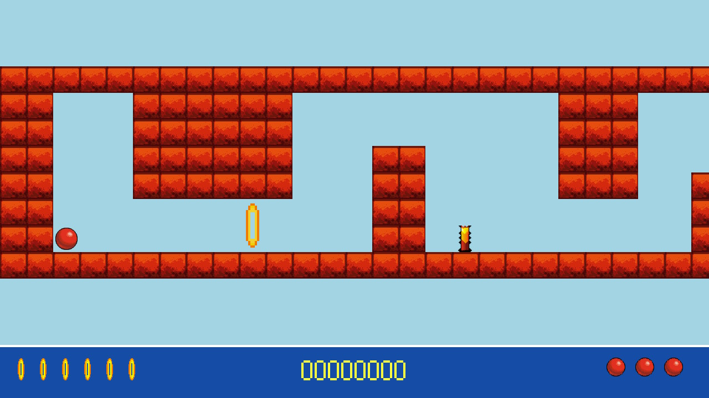
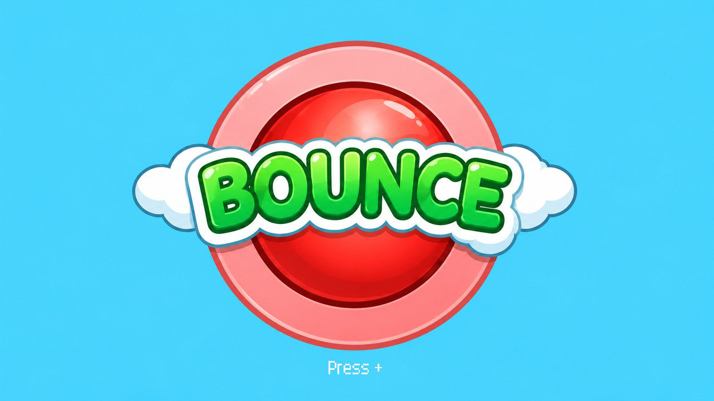
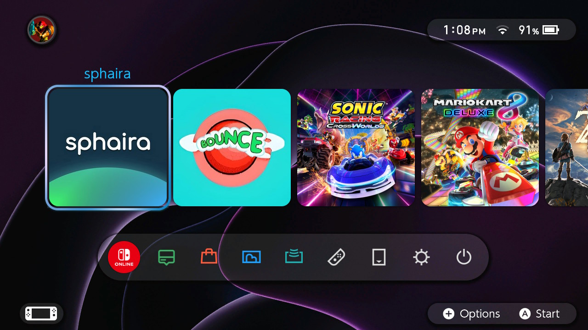

# Bounce NX

Bounce for Nintendo Switch, ported from [Bounce Vita](https://github.com/M-Essa11/Bounce-Vita).
All 11 classic levels, updated artwork, sound effects, and saved progress.

## Screenshots

### Gameplay



### Title screen



### Switch HOME menu



## Install

1. Download the ZIP from [Releases](https://github.com/M-Essa11/Bounce-NX/releases).
2. Extract it onto the root of your microSD card.
3. Open **Bounce NX** in the Homebrew Menu. Hold **R** while starting a game to open it in application mode.

The game goes here:

```
sd:/switch/bounce-nx/bounce-nx.nro
```

Updating? Replace the NRO. Keep your `save.dat`.

## Controls

| Button | Action |
| --- | --- |
| D-pad / left stick | Move and navigate |
| A | Jump / confirm |
| B | Back |
| + | Start / pause to menu |
| - | Save and exit |
| L / ZL | Move left |
| R / ZR | Move right |
| X + Y | Toggle invincibility |

Saves are stored in `sd:/switch/bounce-nx/save.dat`. Continue keeps your level,
score and lives. After closing the app, it restarts that level from the beginning.

## v1.00 — ramp fixes

Added [Super-Matter's physics fixes](https://github.com/M-Essa11/Bounce-Vita/pull/1):

- The ball keeps its speed while travelling uphill on ramps.
- Airborne impacts still bounce correctly off normal and rubber ramps.
- Floor and ceiling collisions work correctly when gravity is reversed.

Tested on my Switch Lite. The desktop physics regression tests also pass.

This also includes the fullscreen menus, readable text, HD ball logo and new cover
from the previous test build.

## Build

Install devkitPro and its Switch tools. In the devkitPro MSYS2 shell:

```sh
pacman -S --needed switch-dev switch-sdl2 switch-sdl2_image
cd /c/Projects/Bounce-NX
bash build-nx.sh
```

Use a folder without spaces. The output is `bounce-nx.nro`, with the game data
bundled inside. Python 3 can create the release ZIP with `python tools/package_nx.py`.

Desktop regression tests use host GCC: `bash test-nx-host.sh` after preparing the
assets with `bash build-nx.sh` or `python tools/prepare_nx.py`.

If the game fails to start, check `sd:/switch/bounce-nx/bounce-nx.log`.
The original Vita build instructions are in [README-Vita.md](README-Vita.md).

## Credits

- Nokia / Sun Microsystems — original Bounce.
- [amdray/bounce_zero](https://github.com/amdray/bounce_zero) — C reimplementation.
- M-Essa11 — Vita and Switch ports, artwork and presentation updates.
- [Super-Matter](https://github.com/Super-Matter) — ramp and reverse-gravity physics fixes.
- devkitPro, libnx and SDL contributors — tools and libraries.

Source code: MIT. Original game names and assets belong to their respective owners.
See [LICENSE](LICENSE) and [NOTICE.md](NOTICE.md).
